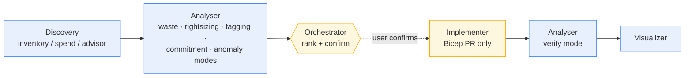

# finops-squad

An IDE-first, multi-agent squad for **GitHub Copilot in VS Code** that takes an Azure estate from
*"what are we spending?"* to *"here is the PR that fixes it"* — and then confirms the savings
actually landed.

- **Read-only against Azure.** Agents use Reader / Cost Management Reader / Monitoring Reader only.
- **PR-only remediation.** Changes are delivered as pull requests to a Bicep IaC repo, gated by risk
  tiers, with a human in the loop.
- **Honest numbers.** Estimates are labelled with a price basis and confidence; a saving is
  "realised" only after verification against later cost data.
- **Microsoft backends only.** Azure MCP server (`@azure/mcp`) plus the host-integrated `arm` tool
  group (Resource Graph, cost querying, retail pricing) available directly in Copilot/VS Code
  agent sessions.

## Pipeline

```text
Discover -> Analyse ---------------------------> Rank -> Confirm -> Implement -> Verify -> Visualize
 Discovery  Analyser (waste/rightsizing/           Orchestrator        Implementer  Analyser   Visualizer
            tagging/commitment/anomaly modes)                                      (verify mode)
```



All blue nodes are **read-only** against Azure. Only the Implementer writes anything, and only as a
pull request — never to live resources. The orchestrator → Implementer edge requires explicit user
confirmation.

## The squad

Five agents. The Analyser is one agent invoked in different **modes** rather than five separate
agents — the mode-specific knowledge lives in skills, which are loaded on demand.

| Agent | Role |
|---|---|
| `finops-orchestrator` | Entry point: scope, sequence, rank, confirm |
| `finops-discovery` | Inventory, spend, Advisor data |
| `finops-analyser` | Modes: `waste`, `rightsizing`, `tagging`, `commitment`, `anomaly`, `verify` |
| `finops-implementer` | Opens Bicep PRs, enforces tiers (never mutates Azure) |
| `finops-visualizer` | Executive summary, engineer backlog, savings ledger, dashboard |

Agents communicate through schema-valid artifacts under `.finops/` (git-ignored). See
[docs/architecture.md](docs/architecture.md).

## Repository layout

```text
.github/
  copilot-instructions.md        # global, binding rules
  agents/                        # 5 .agent.md definitions
  prompts/                       # run-audit, verify-savings, quick-waste-scan
  skills/                        # 22 SKILL.md how-to packs
  instructions/                  # bicep + .finops/** targeted rules
.vscode/mcp.json.example         # MCP config template (git-ignored once copied)
schemas/                         # finding + verification JSON Schemas
scripts/                         # validate-findings.py, ledger.py, kpis.py, dashboard.py, dashboard_helpers.py
fixtures/                        # offline sample data
docs/                            # architecture, capability map, tool inventory, risk tiers,
                                 # security model, getting started, config example,
                                 # scheduling recurring runs, skill authoring guide
```

## Quick start

1. `az login` and select your subscription.
2. `cp .vscode/mcp.json.example .vscode/mcp.json`, then restart MCP servers in VS Code.
3. `cp docs/config.example.json .finops/config.json` and edit it.
4. `pip install jsonschema`.
5. In Copilot agent mode, run the **run-audit** prompt (or ask `finops-orchestrator` to run an
   audit). It stops before remediation and shows ranked findings.
6. Validate: `python scripts/validate-findings.py .finops/runs/<id>/`.

Full walkthrough: [docs/getting-started.md](docs/getting-started.md).

## Dashboard

An interactive, read-only [Streamlit](https://streamlit.io) dashboard visualizes any run's
artifacts. It has two genuinely different views of the same data, chosen with the **View for**
control at the top of the page:

- **Executive** — one plain-English page, no raw tables: a headline sentence (spend and savings are
  stated in separate clauses, currencies are never combined), four KPI cards (monthly spend
  run-rate, estimated opportunity split by what blocks it, realised savings, tag compliance vs the
  90% target with its "approximate" caveat in plain words), a spend-over-time chart with up to three plain-English events (for example "Application
  Gateway charges stopped"), the top 5 cost drivers (with any
  per-service note such as "already deleted"), a card for each **decision needed**, progress bars
  against the iteration goals, a collapsed "How reliable are these numbers?" section, and the
  run's `executive-summary.md` (with a download button) when it exists. It never shows finding
  ids, tier codes, IaC details or resource ids.
- **Engineering** — four tabs, landing on the work queue:
  - **Work queue** — an action-bucket filter (Ready for PR / Blocked on IaC / Decision needed /
    In flight / Informational) over the findings table. Select a row for the evidence (tool and
    query as code), the resource with an Azure Portal link, and a "what blocks this / next step"
    line. `engineer-backlog.md` is shown in an expander when it exists.
  - **Spend** — a daily spend timeline (service multiselect, stacked/lines toggle, an events
    table), then spend by service and by resource group, with the window and source caveats.
  - **Governance** — tag coverage per required tag, iteration goals, and findings by type, tier
    and status.
  - **History & data quality** — KPI cards with sparklines and every KPI's method/unavailable
    note, the KPI trend, run comparison (resolved / recurring / new), `run-status.md`, and an
    artifacts checklist for each run.

Both views compute their numbers from the same helpers, so they cannot disagree. Engineering is
the default. Share a link to a specific view with query parameters:
`?view=executive|engineering&run=<run id>` (for example
`http://localhost:8501/?view=executive&run=20261015-1245`); invalid values fall back to the
defaults. The look is set by `.streamlit/config.toml` (light and dark themes, minimal toolbar) and
`scripts/dashboard_theme.py`. Requires Streamlit 1.50 or newer.

The spend timeline needs the daily cost series that Discovery now captures in `spend.json`
(`daily`); older runs without it show "Daily data not captured — re-run Discovery" instead of
anything invented. Events — a service that **stopped**, **started**, had a sustained **step
change** or a **spike** — are detected from the settled days only: the last three days are still
settling, so they are drawn dashed and lighter and never used for detection. Add your own notes in
`.finops/events.json` (`[{"date": "2026-09-11", "label": "Moved the gateway", "service":
"Application Gateway"}]`). The dashboard also warns if the daily figures differ from the period
total by more than 1%.

```bash
python scripts/validate_discovery.py .finops/runs/<id>/   # check Discovery's output (daily series, tag data)
python scripts/spend_events.py .finops/runs/<id>/         # optional: write reports/spend-events.json
```

> **Offline-verified:** the daily series, validator, event detection and charts are tested against
> fixtures only. The extra Daily-grain `arm.query_costs` call has not yet been run against a real
> Azure subscription.

```bash
pip install -r requirements-dev.txt
python scripts/kpis.py .finops/runs/<id>/ --runs-dir .finops/runs  # optional, for the KPI tab
streamlit run scripts/dashboard.py
```

Pick a run from the control row at the top of the page. The dashboard reads `.finops/runs/<id>/` only — it never calls Azure
and never mutates artifacts, and it keeps estimated and realised savings strictly separate. See
[docs/scheduling-recurring-runs.md](docs/scheduling-recurring-runs.md) for keeping multiple runs
accumulating so the trend/comparison views have real data to show.

## Status

MCP servers connected and tool inventory captured. Repository scaffold, schemas, scripts, fixtures,
all agents, skills, instructions and prompts are in place. **Spend querying, Resource Graph, and
retail pricing are live-verified** via the host-integrated `arm` tool (`query_costs`,
`execute_query`, `get_retail_prices`) — see [docs/mcp-capability-map.md](docs/mcp-capability-map.md)
for the full correction from an earlier assessment. **Budgets, cost forecasting, and
commitment/reservation listing are still unavailable** from any backend found so far.

## License

[MIT](LICENSE).
