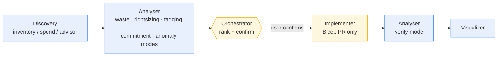

# finops-squad

An IDE-first, multi-agent squad for **GitHub Copilot in VS Code** that takes an Azure estate from
*"what are we spending?"* to *"here is the PR that fixes it"* — and then confirms the savings
actually landed.

- **Read-only against Azure.** Agents use Reader / Cost Management Reader / Monitoring Reader only.
- **PR-only remediation.** Changes are delivered as pull requests to a Bicep IaC repo, gated by risk
  tiers, with a human in the loop.
- **Honest numbers.** Estimates are labelled with a price basis and confidence; a saving is
  "realised" only after verification against later cost data.
- **Microsoft backends only.** Azure MCP server (`@azure/mcp`) plus the host-integrated `arm` tool
  group (Resource Graph, cost querying, retail pricing) available directly in Copilot/VS Code
  agent sessions.

## Pipeline

```text
Discover -> Analyse ---------------------------> Rank -> Confirm -> Implement -> Verify -> Visualize
 Discovery  Analyser (waste/rightsizing/           Orchestrator        Implementer  Analyser   Visualizer
            tagging/commitment/anomaly modes)                                      (verify mode)
```



All blue nodes are **read-only** against Azure. Only the Implementer writes anything, and only as a
pull request — never to live resources. The orchestrator → Implementer edge requires explicit user
confirmation.

## The squad

Five agents. The Analyser is one agent invoked in different **modes** rather than five separate
agents — the mode-specific knowledge lives in skills, which are loaded on demand.

| Agent | Role |
|---|---|
| `finops-orchestrator` | Entry point: scope, sequence, rank, confirm |
| `finops-discovery` | Inventory, spend, Advisor data |
| `finops-analyser` | Modes: `waste`, `rightsizing`, `tagging`, `commitment`, `anomaly`, `verify` |
| `finops-implementer` | Opens Bicep PRs, enforces tiers (never mutates Azure) |
| `finops-visualizer` | Executive summary, engineer backlog, savings ledger, dashboard |

Agents communicate through schema-valid artifacts under `.finops/` (git-ignored). See
[docs/architecture.md](docs/architecture.md).

## Repository layout

```text
.github/
  copilot-instructions.md        # global, binding rules
  agents/                        # 5 .agent.md definitions
  prompts/                       # run-audit, verify-savings, quick-waste-scan
  skills/                        # 19 SKILL.md how-to packs
  instructions/                  # bicep + .finops/** targeted rules
.vscode/mcp.json.example         # MCP config template (git-ignored once copied)
schemas/                         # finding + verification JSON Schemas
scripts/                         # validate-findings.py, ledger.py, dashboard.py
fixtures/                        # offline sample data
docs/                            # architecture, capability map, tool inventory, risk tiers,
                                 # security model, getting started, config example
```

## Quick start

1. `az login` and select your subscription.
2. `cp .vscode/mcp.json.example .vscode/mcp.json`, then restart MCP servers in VS Code.
3. `cp docs/config.example.json .finops/config.json` and edit it.
4. `pip install jsonschema`.
5. In Copilot agent mode, run the **run-audit** prompt (or ask `finops-orchestrator` to run an
   audit). It stops before remediation and shows ranked findings.
6. Validate: `python scripts/validate-findings.py .finops/runs/<id>/`.

Full walkthrough: [docs/getting-started.md](docs/getting-started.md).

## Dashboard

An interactive, read-only [Streamlit](https://streamlit.io) dashboard visualizes any run's
artifacts — estimated vs realised savings, savings by type, findings by risk tier, a status funnel,
a sortable findings table with evidence, and spend trend (or an honest "spend data unavailable"
banner).

```bash
pip install -r requirements-dev.txt
streamlit run scripts/dashboard.py
```

Pick a run from the sidebar. The dashboard reads `.finops/runs/<id>/` only — it never calls Azure
and never mutates artifacts, and it keeps estimated and realised savings strictly separate.

## Status

MCP servers connected and tool inventory captured. Repository scaffold, schemas, scripts, fixtures,
all agents, skills, instructions and prompts are in place. **Spend querying, Resource Graph, and
retail pricing are live-verified** via the host-integrated `arm` tool (`query_costs`,
`execute_query`, `get_retail_prices`) — see [docs/mcp-capability-map.md](docs/mcp-capability-map.md)
for the full correction from an earlier assessment. **Budgets, cost forecasting, and
commitment/reservation listing are still unavailable** from any backend found so far.

## License

[MIT](LICENSE).
