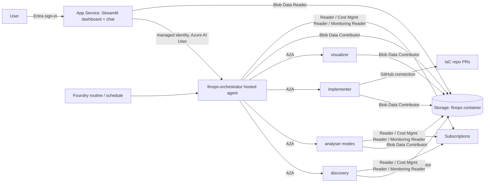

# Foundry migration plan

Target: Foundry project `danidu-agentic-migrations`
(`https://danidu-agentic-migrations.services.ai.azure.com/api/projects/danidu-agentic-migrations`).

Status: **phases 0-5 done** (skills, storage `stfinopsdanidu`, five hosted agents, orchestration, dashboard at
`https://finops-dash-danidu.azurewebsites.net` with Entra auth, `infra/dashboard/main.bicep`; deploy by zipping
`scripts/{dashboard,dashboard_helpers,blob_sync}.py` plus `infra/dashboard/requirements.txt` as `requirements.txt`).
Phases 6-8 (chat, schedule, CI/CD) pending. Principles in `.github/copilot-instructions.md` still apply
(read-only Azure, PR-only remediation, human confirmation before the Implementer, honest numbers).

## Goals

1. All five agents and their skills run in Foundry as hosted agents.
2. Every run's exports (inventory, spend, findings, reports) per subscription go to a storage account.
3. The dashboard runs on App Service with Entra authentication and reads from that storage account.
4. A chat window in the dashboard talks to the `finops-orchestrator` agent.
5. FinOps runs can be triggered on a schedule.

## Target architecture

## Phases

### 0. Baseline

- Install `azd` (required by the Foundry skill's dependency check).
- Confirm access, network and RBAC on the project; deploy a model.
- Re-verify `docs/mcp-capability-map.md` against the Foundry host: `arm.query_costs` is host-specific
  and may not exist there. Decide replacements (Cost Management / Resource Graph REST via tool or
  Azure MCP server connected to the agent).
- Decisions: framework (default Microsoft Agent Framework), orchestration (default A2A).

### 1. Skills

- Register the 22 `.github/skills` as Foundry Skills and attach via toolbox.
- `.github/skills` stays the source of truth; CI syncs to Foundry.

### 2. Storage account and state layer

- Bicep (AVM): storage account, `finops` container, versioning, soft delete, no public blob access,
  lifecycle rule (Cool after N days), diagnostics.
- Layout mirrors `.finops/`: `<subscriptionId>/runs/<yyyymmdd-hhmm>/{inventory,spend,advisor}.json`,
  `findings/`, `investigations/`, `verification/`, `reports/`, `run-status.md`, `plan.md`.
  Subscription id is the top-level partition so each subscription's exports are separate.
- Shared `finops_store` library: read/write blobs, runs `validate-findings` before writing findings
  and verification files. Agents use it instead of local file I/O.
- `config.json` (subscription IDs) is not stored in the container; supplied as agent configuration.
- Optional: one-off script to upload existing local `.finops/runs`.

### 3. Hosted agents (one at a time)

Order: discovery -> analyser (waste, rightsizing, tagging, commitment, anomaly, verify) ->
visualizer -> implementer -> orchestrator.

- `azd ai agent init --deploy-mode code` per agent, `azure.yaml` per service.
- Per-agent managed identity: Reader + Cost Management Reader + Monitoring Reader only;
  Storage Blob Data Contributor on the `finops` container. Implementer: GitHub connection, no Azure write.
- Guardrail blocking mutating tools.

### 4. Orchestration (done)

- Built: the orchestrator embeds the specialists in-process (`Agent.as_tool`) with their tools and skills. Agent-to-agent
  calls over the endpoint were tried and fail, because a callee only gets a trusted user ID from a signed-in user, not a
  managed identity. The standalone agents remain callable directly. Analyser modes run in parallel via parallel tool calls.
- gpt-4.1 is capped at 50K TPM, so a full parallel pass can be rate limited; raise capacity or run modes sequentially.
- Artifact verification reads blobs, not agent summaries.
- The Implementer is reached only through `draft_pull_request`, which requires the user's approval text. A dashboard
  approval button comes in phase 6.

### 5. Dashboard on App Service

- Linux App Service (Python), `streamlit run`, WebSockets on.
- Replace local-file reads in `scripts/dashboard.py` / `dashboard_helpers.py` with a read-only blob
  reader (`DefaultAzureCredential`; local falls back to developer sign-in). Subscription and run pickers
  driven by the container listing. `st.cache_data` with short TTL.
- Easy Auth (Entra ID) enabled, anonymous access blocked, access limited to your user/group.
- Managed identity: Storage Blob Data Reader on the container.
- Optional hardening: private endpoint / storage firewall to the app.
- Bicep (AVM): plan, web app, identity, role assignments. GitHub Actions deploy workflow.

### 6. Chat window

- `st.chat_input` / `st.chat_message`, streamed replies from the orchestrator's Foundry endpoint.
- App managed identity has Azure AI User on the project; signed-in user's name (Easy Auth header) is
  logged per call.
- Modes: ask about an existing run (selected `run_id` passed from the loaded run list) and start a
  new audit (standard prompt plus status panel polling `run-status.md`).
- Limits: message length and per-session rate; no free-form paths from the UI.
- Remediation requests still require the explicit confirmation button.

### 7. Scheduling

- Foundry routines (`azd` routine CRUD) trigger the orchestrator, e.g. weekly discovery + analysis
  per subscription, and a verify run after merged PRs.
- Scheduled runs are scan-only: they stop at `plan.md`; the Implementer is never auto-chained.
- Run ID and status written to storage so the dashboard shows scheduled runs.
- Alerts on failed runs (Azure Monitor).

### 8. Quality, CI/CD, observability

- Eval datasets from `evals/` and the skills' worked examples; batch evals per agent.
- CI/CD workflow for agent and skill deploys.
- Tracing to App Insights; trace and troubleshoot flow documented.

## Open decisions

| Decision | Default |
|---|---|
| Agent framework | Microsoft Agent Framework |
| Orchestrator -> sub-agents | A2A |
| Storage account | New, created by Bicep in this repo |
| Chat scope | Q&A on runs plus start audits (confirm) |
| Schedule cadence | Weekly scan, monthly verify (confirm) |

## Risks

- `arm` tool portability (see Phase 0).
- Cost Management API rate limits when several subscriptions run on a schedule.
- Preview features (hosted agents, routines, managed harness) may change.
- Dashboard and storage contain spend data: keep Entra auth, RBAC-only storage, no public access.

> **Update:** the five agents were consolidated into a single hosted agent, `finops-squad` (all 23 skills, one tool set). Query tools save full results to blob (`save_as`) and return previews; older tool results are compacted; gpt-4.1 capacity raised to 1000. The dashboard chat now targets `finops-squad`. The old five agents remain in Foundry and can be deleted.
